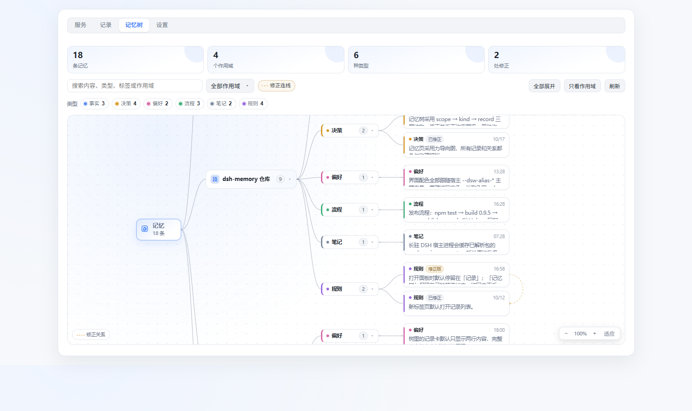
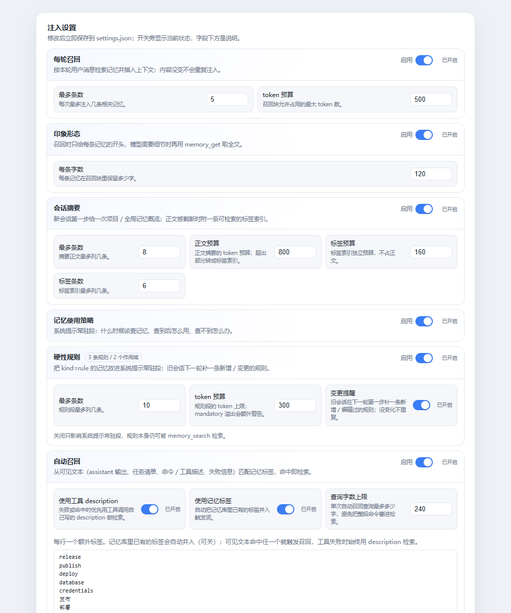

# dsh-memory

DeepSeek Harness 的本地长期记忆插件 —— **一个包、一条 Loader entry、四个半边**:JSONL 存储 + 本地向量检索(llama-server,OpenAI 兼容)+ 五个模型工具 + 自动召回注入 + 设置页管理面板。

[](https://www.npmjs.com/package/@restregular/dsh-memory)
[](./LICENSE)

English: Local, durable memory for DeepSeek Harness — one npm package, one loader entry: a JSONL store, local vector recall through llama-server, four model-facing tools, automatic recall injection, and a management panel in the settings page.

## 预览 / Preview

设置页 →「记忆」:顶部统计(记忆数 / 作用域数 / 待嵌入向量)、向量服务(运行状态、本机配置、当前模型)、维护(卸载向量服务 / 清空记忆数据)、记录列表(搜索 + 作用域筛选 + 按 scope / 类型 / 时间展开),以及按**作用域 → 类型 → 记录**分层展示、带修正关系连线的**记忆树**。


「记忆树」标签页:金色虚线表示 `supersedes`(新记录修正旧记录),点节点看详情,悬停或选中时整条修正链一起点亮。



设置页「记忆 → 设置」的卡片式布局:每个开关都有可见 label、说明和状态,自动召回标签在同卡编辑。



模型在对话里查记忆 —— `memory_search` 的入参与召回结果:


## 它给你什么

| 能力 | 说明 |
| --- | --- |
| **落盘存储** | 每条记忆一行 JSONL,按 scope 分文件(会话 / project / global / 自定义),同 scope 内按内容去重;写入前过凭据扫描 |
| **作用域** | 默认写进**当前会话**;读默认合并「会话 + 项目 + global」。也能写 `global`、当前项目,或任意自定义名(首次写入自动建) |
| **双通道检索** | 词法(IDF + CJK bigram)**+** 向量(llama-server 的 `/v1/embeddings`)。向量缺席时自动降级为纯词法,**不报错、不阻塞** |
| **自动召回** | `agent/pre-step` 注入相关记忆(可关、有 token 预算、按 topK 截断,范围同为会话+项目+global) |
| **印象形态** | 每轮只给每条记忆的短摘要;模型判断相关但需要细节时再 `memory_search` 取全文(可在面板关掉,退回长文召回) |
| **会话摘要** | 会话第一步注入一次「已有记忆」概览:项目 + global 按**重要度 × 新鲜度**挑几条,省得模型从头摸索 |
| **记忆使用策略** | 系统提示常驻段:什么时候该查记忆、查到怎么复用、查不到时低风险推断 / 高风险先问用户 |
| **硬性规则** | `kind: rule` 的记忆进系统提示常驻段(限量、可关);**新增/改过的规则会在旧会话的下一轮补一条提醒**(同一条只提醒一次)。能机械校验的规则应该做成钩子,提示词只做解释 |
| **五个工具** | `memory_save` / `memory_search` / `memory_list` / `memory_get` / `memory_forget`(摘要带 8 位 id,`memory_get` 直接取全文) |
| **管理面板** | 设置页「记忆」:记录(浏览 / 搜索 / 新建 / 编辑 / 删除)+ **记忆树**(作用域 / 类型 / 修正关系可视化、折叠、筛选、缩放与详情)+ 设置(召回、摘要、印象、策略、规则、轮末提醒逐项开关、导入导出)、向量服务启停、模型与硬件、维护(卸载 / 清空) |
| **向量后端一键装** | 面板里选模型 → 下 llama.cpp 运行时 + 模型 → 托管 `llama-server` 进程;内置 8 个模型 + 硬件推荐 + 自定义 GGUF |

## 安装 / Install

```bash
pnpm add @restregular/dsh-memory
# 或 npm i @restregular/dsh-memory
```

装进任意 DSH profile(桌面端 `~/.dsh/profiles/desktop`,Web 端 `~/.dsh/profiles/web`)。包自带 `cordis.patch.yml`,装好后自动注册**唯一一条** entry:

```yaml
- insert:
    - id: dsh-memory
      name: '@restregular/dsh-memory'
```

**不写任何配置就能用**:检索退化为词法,一个网络请求都不发。

### 为什么是一个包

宿主的 `dsh-client-modules` 只在「某条**活的** Loader entry 能解析到包名」时才为该包提供 client bundle,并且 `reconcilePackage` 要求**一个包名只有一个解析源**(否则抛 `resolves from multiple active Loader sources` → 客户端图组合失败 → 桌面端 fail-loud 起不来)。所以「一个包 + 一个面板」的稳定形态只有一个:**一个包名、一条 entry、两侧都在**(与 `dshmarket` 同形)。

早期把 provider / 工具 / 注入 / 面板拆成两个包、四条 entry;现在合并为一条 entry,由 `lib/index.js` 组合四个半边,每个半边各自 try/catch —— **任何一半失败都只记一行日志,绝不让 DSH 启动失败**。

| 半边 | 作用 |
| --- | --- |
| `lib/provider` | 提供 `memory` 服务:JSONL 存储、双通道检索、向量回填、向量后端生命周期与一键安装 |
| `lib/tools` | 注册 `memory_save` / `memory_search` / `memory_list` / `memory_get` / `memory_forget` |
| `lib/inject` | 在 `agent/pre-step` 注入召回块(可关) |
| `lib/panel` | `/memory/api` 管理接口(含同源 / 登录围栏) |
| `lib/client.js` | 设置页「记忆」区块(注册 id == 包名) |

## 快速开始

**1. 存一条记忆**(模型自己会调,你也可以在对话里要求):

```jsonc
memory_save({
  "content": "本仓库用 pnpm 11 安装依赖,PATH 上的 pnpm 10 会踩 ERR_PNPM_UNEXPECTED_STORE",  // 必填,自洽的一句话
  "path": "D:/repositories/dsh-memory",  // 可选:工作区目录 → 写入 project:<该路径>
  "scope": "dsh-memory",     // 配合 path 时 = 这个作用域的显示名(别名);不给就用路径本身
  "kind": "fact",            // fact / decision / preference / procedure / note / rule
  "tags": ["pnpm", "toolchain"],
  "importance": 0.8          // 0~1
})
```

作用域怎么选:

| 写法 | 含义 |
| --- | --- |
| 省略 / `session` | **当前会话**(子代理共享父会话;拿不到会话信息时回退到当前项目) |
| `project` | 当前工作区(键是 `project:<cwd>`) |
| `path` + 可选 `scope` | **指定工作区目录**:写入 `project:<路径>`,`scope` 变成这个作用域的显示名(别名) |
| `global` | 所有项目共享 |
| `handbook`、`项目笔记` … | **自定义作用域**:任意名字,首次 `memory_save` 时自动创建 |
| `session:<id>` / `project:<path>` | 显式钉住某个会话 / 某个工作区 |
| `<已登记的别名>` | 读取时可以直接用别名找项目作用域 |
| `all` / `*` | **只在读取时可用**:跨所有已发现的作用域;写入会明确报错 |

**作用域重命名(别名)**:项目作用域的身份永远是 `project:<绝对路径>`,别名只影响显示与引用,不迁移数据。规则:
- 同一路径重复用同一个名字 = 幂等;换名字 = 覆盖原别名;
- **另一个路径抢同一个名字 → 拒绝保存**(`SCOPE_NAME_TAKEN`);
- 只有项目作用域能起别名(`global` / `session` 不支持,报 `SCOPE_NAME_UNSUPPORTED`);
- 别名落盘在 `<storeDir>/scopes.json`,面板的作用域筛选项显示别名。

**2. 检索**:`memory_search({ query: "pnpm 装依赖", topK: 5 })` —— 省略 `scope` = 会话 + 项目 + global 合并(按来源标注、按 id 去重);`scope: "all"` 查所有作用域;写具体名字则只查那一个。
**3. 按 id 取全文**:召回 / 摘要每行开头是 8 位 id 前缀,`memory_get({ ids: ["3f2a9c1d"] })` 直接拿原文,不用再检索。
**4. 列出 / 忘记**:`memory_list({ limit: 20 })`(默认只列当前会话,末尾附作用域清单 + 记录数)、`memory_forget({ id })` 或 `memory_forget({ query, scope })`(按内容删默认**只作用于当前会话**,防止跨作用域误删)。

**5. 打开面板**:设置页 →「记忆」;也可以在「设置 → 侧栏入口」打开左侧栏的「记忆」按钮,点击在主界面打开面板。面板分四个标签:

- **服务**:「向量服务」:状态、地址、启停开关、**模型与硬件**(见下)、维护(卸载向量服务 / 清空记忆数据,两步确认)
- **记录**(默认打开):顶部统计(记忆数 / 作用域数 / 待嵌入向量数)、搜索、按作用域筛选、**新建**(任意作用域 + 类型,类型里含 `rule`)、展开编辑 / 删除;列表放在独立的滚动容器里(记忆再多也不把面板撑长),滚动条是自定义的细圆头样式,从侧栏入口打开时容器还会跟着窗口长高;作用域下拉**动态枚举实际存在的作用域**(`global` 显示「全局」、project 显示 cwd、会话 scope 显示会话标题、自定义 scope 显示原名)
- **记忆树**:所有作用域的记忆按 **作用域 → 类型 → 记录** 三层展开,根节点显示总数;记录卡按类型着色,`supersedes` / `supersededBy` 用金色虚线把「修正版」和「被修正的旧版」连起来。支持搜索(命中高亮、其余淡出)、按类型逐个开关、按作用域筛选、折叠作用域 / 类型、缩放与「适应」、以及点击记录打开的详情抽屉(全文、标签、重要度、时间、id 与双向修正链)。修正是**关系**而不是层级,所以不改变树结构,只叠在右侧;悬停或选中一条记录时,整条修正链一起点亮
- **设置**:注入链路逐项开关 —— 每轮召回(topK / 预算)、印象形态(每条字数)、会话摘要(条数 / 正文预算 / 截断标签预算 / 标签条数)、记忆使用策略段、硬性规则段(条数 / 预算 / 变更提醒,并显示当前规则条数)、自动召回(标签 / 是否用工具 description / 是否并入记忆库标签 / 查询字数)、轮末提醒、侧栏入口;底部「数据」:导出全部 / 导入文件。改完**即保存**,不需要点按钮

> **导入 / 导出**:导出的是纯文本 —— 作用域、类型、内容、标签、重要度、时间戳,**没有向量**。导入时逐条走保存路径,按**当前模型重新嵌入**,并按「作用域 + 内容」去重(重复的计入「跳过」)。一次最多 5000 条。

面板后端在 `/memory/api`,全部路由:`GET /status`、`GET /records`、`GET /settings`、`POST /settings`、`GET /audit`、`POST /create`、`POST /update`、`POST /delete`、`GET /export`、`POST /import`、`GET /embed/status`、`POST /embed/start|stop`、`GET /embed/model`、`POST /embed/model/refresh|install|install/cancel|uninstall`、`POST /data/wipe`。

## 注入可靠性(0.9.6 – 0.9.7)

摘要和规则不再静默截断:

- **正文预算**:`digest.tokenBudget` 默认从 400 提到 800;`topK` 与预算仍是两个独立上限。
- **截断标签**:正文因 `topK` / 预算没注入时,附一条独立的「相关记忆索引」——每条只给 8 位 id、标签/主题、类型、作用域,以及 `memory_search` 检索指引;标签有 `digest.hintBudget` / `digest.hintMaxItems` 独立预算。标签也溢出时报告省略数量与原因。
- **退役规则**:被 `supersedes` 指向的旧记录不再进入摘要、规则段和自动召回;`memory_search` / `memory_get` 仍可查历史。
- **mandatory / pinned**:规则标签里写 `mandatory` / `pinned`(或 `必含` / `强制`)的条目排在规则段最前;超预算时输出明确警告,不静默丢弃。
- **标签触发的行为召回(0.9.7)**:设置里的 `autoRecall.tags` 是**标签**,不是正则;默认还会并入记忆库里已有的标签(`useMemoryTags`)。自动召回只检索 **global + 当前会话 + 当前工作区**,不含自定义作用域 / fork 父会话;普通每轮召回仍按原配置。匹配源包括 `tool/call` 的 name / description / 参数、`tool/result` 的失败描述、可见 `assistant/message` 文本、`todo/write` 任务清单、`command/run`、`goal/change`。命中标签后,在下一个 `agent/pre-step` 用标签 + 命中片段检索;工具失败则始终用该工具调用自己的 `description`(取不到才退回错误类别)。中英标签有最小同义词映射(如 `deploy` ↔ 部署、`database` ↔ 数据库)。
- **去重**:已注入正文按 **sessionId + 记忆 id/版本** 跳过;只给过标签的会补正文;内容更新会重新评估;compaction 后重置摘要与去重状态。
- **标签可检索**:`search` 的词法通道把记录标签也并入检索文本,所以中文正文 + 英文标签也能被标签查询命中。
- **审计**:每次摘要/召回/规则评估写入内存审计环,`GET /memory/api/audit?session=<id>` 可查触发原因、阶段、候选、正文、标签、去重、省略原因与各通道预算;不记录凭据。
- **限制**:行为召回发生在**下一个** `agent/pre-step`;宿主虽有 `tools/pre-execute`,本插件没有用它做操作前硬阻断。不读取隐藏思维链:只消费可见 text 块、任务清单、命令/工具描述与失败信息。工具失败若底层只返回 aborted,审计会保留 `ABORTED_UNKNOWN`,不会臆测成凭据问题。

## 数据与文件布局

| 路径 | 内容 |
| --- | --- |
| `<storeDir>/global.jsonl` | global 作用域的记忆,一行一条 |
| `<storeDir>/projects/<sha1(scope)>.jsonl` | 其它作用域(会话 / 项目 / 自定义)各一个文件;文件名是 scope 键的 SHA-1,所以名字里带路径分隔符也不可能穿越 |
| `<storeDir>/projects/<sha1(scope)>.vec` | 向量边车。首行是身份头 `#<model>\t<dims>\t<pooling>`(0.10.0 起;老文件只有前两段,仍兼容),后面每行 `id\t<base64 向量>` |
| `<storeDir>/settings.json` | 面板「设置」里改过的注入开关(配置里的值是默认值,这里覆盖它) |
| `<storeDir>/scopes.json` | 项目作用域的别名(显示名 → `project:<路径>`),同一路径同名幂等,不同路径同名拒绝 |
| `<storeDir>/*.lock` | 写入期间的临时锁文件(同一 scope 的跨进程写锁),写完立即删除 |
| `<installRoot>/llamacpp/` | llama-server 运行时(exe + 依赖 dll + `llama-server.log`) |
| `<installRoot>/models/` | 下载的 GGUF 模型 |
| `<installRoot>/selected-model.json` | 面板里选过哪一档(比配置优先级低) |

`storeDir` 默认 `.dsh-memory`(相对启动目录),**建议显式配一个绝对路径**。文件是**首次写入才创建**(读一个不存在的 scope 只会得到空结果,不会造出空文件);`projects/` 目录在插件启动时就建好。**作用域被删空后,它的 `.jsonl` 与 `.vec` 会在下一次落盘时一起移除**(0.5.1 起),不会再留下 0 字节文件;下次写同一个名字会重新创建。唯一例外是 `global.jsonl`:保留作用域删空后只清内容、保留文件。

scope 键的三种形态:`global`、`project:<cwd>`、`session:<会话 id>`,其余都是自定义名(小写折叠、内部空白折成一个空格、最长 64 字符,禁止 `:`、路径分隔符、控制字符、`..` 与保留名 `global/project/session/all`)。**没有任何数据迁移**:旧的 `project:<cwd>` 文件继续原样读写。

`installRoot` 默认 `~/.dsh/memory-vector`;显式配了 `storeDir` 时取**它的父目录**(所以手写的 `<root>/llamacpp` + `<root>/models` 布局会被直接认出来)。

> **换模型 = 向量作废重建**。`.vec` 的身份头记录 `model`、`dims` 与 `pooling`(0.10.0 起),任一对不上就整份丢弃并重新嵌入;重建期间检索暂时只用词法。面板会在换之前告诉你涉及多少条记忆。老边车只有 `model` + `dims` 两段,按兼容接受,下一次写向量时自动升级成三段。

**多个进程共用一个 `storeDir`**(0.10.0 起):比如插件 + 一个 MCP server,或者同时开两个 DSH 实例。写入按 scope 走锁文件、每次都"锁内重新读盘再合并本次增量",不再用内存快照整份覆盖磁盘;读路径每秒 stat 一次,别的进程刚写的记录不用重启就能看到。实测 4 个进程 × 20 条并发写同一个 scope 零丢失。代价是写路径多了一次读盘 + 一次 stat,量级远小于一次嵌入。已知取舍:同内容去重(`save` 的 dedupe)仍是进程内判断,两个进程同时写**完全相同**的内容理论上会落两条。

## 配置 / Configuration

provider 的配置在顶层,工具 / 注入 / 面板各占一个小节(合并前它们各是独立 entry 的 `config`):

```yaml
- id: dsh-memory
  name: '@restregular/dsh-memory'
  config:
    storeDir: '~/.dsh/memory-store'
    scopes:
      global: true
      project: true
      session: true                         # 会话作用域(默认开)
      custom: { enabled: true, max: 200 }   # 自定义作用域:开关 + 数量上限(只数自定义的)
    retrieval:
      topK: 5
      recallN: 30
      vector:
        enabled: true
        endpoint: 'http://127.0.0.1:8078/v1/embeddings'
        model: bge-m3
        dims: 1024
        timeoutMs: 300            # 交互检索(短查询)预算,要紧
        writeTimeoutMs: 10000     # 保存时嵌整条记录
        backfillTimeoutMs: 30000  # 批量回填
        backfillMaxChars: 8000
        spawn:                    # 让插件托管 llama-server 进程(opt-in)
          enabled: true
          exe: '/path/to/llama-server.exe'
          model: '/path/to/bge-m3-Q4_K_M.gguf'
          cwd: '/path/to/llamacpp'   # 该目录须含 llama-server-impl.dll
          logFile: '/path/to/llama-server.log'
      llm: { enabled: false }     # LLM 重排(可选)
    limits: { maxRecordsPerScope: 2000, maxRecordChars: 4000 }
    secrets: { enabled: true, mode: refuse }
    tools: { defaultScope: session }              # session(新默认)/ project / global;projectScope 默认 project:<会话 cwd>
    inject:
      enabled: true                 # 整个注入半边(含下面的段)的总开关
      extraScopes: ['handbook']     # 可选:额外参与召回的 scope
      # 以下都可以在面板「记忆 → 设置」里改(立即生效);这里是默认值
      recall: { enabled: true, topK: 5, tokenBudget: 500 }
      impression: { enabled: true, chars: 120 }      # 每条只给摘要,细节再 memory_search
      digest: { enabled: true, topK: 8, tokenBudget: 400 }   # 会话第一步的概览
      policy: { enabled: true }                        # 系统提示:记忆使用策略
      rules: { enabled: true, maxItems: 10, tokenBudget: 300, delta: true }  # 系统提示:kind=rule(δ=旧会话补新规则)
      turnEnd: { enabled: false }                      # 轮末提醒(下一轮开头提示落盘)
    panel: { route: '/memory/api' }
```

- **`tools.defaultScope`** 决定*省略 scope 时写到哪*:`session`(0.5.0 起的默认)、`project`、`global`。会话写不进去(宿主没给会话信息、或 `scopes.session: false`)时**自动回退到当前项目**,不报错。
- **`scopes.custom.max`** 只统计自定义作用域(已发现 + 已加载去重);到上限后 `memory_save` 新建会被拒并提示可复用的名字(`SCOPE_LIMIT`),写已有作用域不受限。会话/项目/global 既不计入也不受限。
- **读与写的默认是一致的**:写进会话的东西,`memory_search` 默认就能读回来(合并会话 + 项目 + global,按 id 去重,同分时 session > project > 自定义 > global)。想只看某一个就显式给 `scope`。
- 旧配置(只有 `scopes: { global: true, project: true }`、`tools.defaultScope: project`)照常工作 —— 不写新字段就是新默认值(`session: true`、`custom: { enabled: true, max: 200 }`),想保持 0.4.x 的老行为就显式写 `tools.defaultScope: project`。

- **注入分四层**:`recall`(每轮按问题检索)、`digest`(会话第一步给概览)、`policy`(系统提示常驻的使用策略)、`rules`(系统提示常驻的 `kind=rule` 规则),外加 `turnEnd`(轮末提醒,默认关)。每层独立开关,`inject.enabled: false` 全关。面板改过的值写在 `<storeDir>/settings.json`,**优先级高于这里的配置**。
- **写规则**:`memory_save({ kind: 'rule', content: '改 lib 必须同时改 source' })`。规则会进系统提示常驻段;能机械校验的规则更适合做成钩子,提示词只负责解释。
- **规则变更怎么进旧会话**:系统提示段本身每步都会按 store 快照重渲染,但那只改提示词文本、不产生任何对话消息,旧会话里的模型不会主动重读;而且常驻段有 token 预算,新规则可能被更重要的旧规则挤掉。所以 `rules.delta`(默认开)在一轮的第一步拿「该会话上一轮开始时的规则快照」与当前规则比:新增、以及**编辑过**(同一 id 的行变了)的规则都补一条 `source.kind='memory'` 消息,没变化的不重复;编辑即使被系统提示的刷新"抢先"也会补。旧会话重开 / 宿主重启用历史里的规则行做种子,不会整批重提醒;关掉它只影响这条提醒,常驻段照旧。

向量检索是**按配置启用**的:写了 `endpoint`、配了 `spawn`、或面板里装了本地后端才会碰网络,否则一个请求都不发,检索自动降级为纯词法(IDF + CJK bigram)。不需要自动召回就 `inject.enabled: false`。

`spawn.enabled: true` 时:应用启动后台拉起向量服务、退出时自动关闭;带 PID 文件的遗留实例会被接管,没有 PID 文件的外部实例不接管。

### 模型与硬件

面板「记忆 → 向量服务」里有两行状态气泡 + 一块折叠区:

```
本机配置：[12 核][14GB 内存][显卡 …][磁盘剩余 9GB]        [重新检测硬件]
当前模型：[Qwen3-Embedding-0.6B][Q8_0][1024 维][last][cpu]  [下载并安装]
▸ 模型与硬件
```

- **本机配置 / 当前模型**两行是**标签气泡**,超宽横向滚动(不换行、不显示滚动条);本机配置在**面板一出现**就取一次(服务端对硬件探测有 10 分钟缓存,通常只是读缓存)。
- **内置清单 8 个模型**,下载源与体积都实测过:BGE-M3(Q4_K_M / Q8_0)、Qwen3-Embedding 0.6B / 4B / 8B、Nomic Embed v1.5、BGE 中文 small / base / large。每个模型自带 `dims` 与 `pooling`,**选它就自动配对** —— 维度写错会让检索静默退化成词法,这是最容易踩的坑。
- **按本机推荐**:探测 CPU 核数 / 内存 / 磁盘剩余 / 显卡与显存,推荐那一档在列表里带「推荐」气泡并默认选中。规则:质量优先;能整块放进显存就用 GPU;CPU 上重罚 4B/8B;中文环境优先中文 / 多语言;显存 < 4GB 的核显不算可用显卡(实测:共享显存的核显并不比多核 CPU 快)。
- **运行时风味** `cpu` / `vulkan` / `cuda` / `metal` / `auto`:Vulkan 自包含(驱动自带即可);**CUDA 会把 cudart 伴随包一起下**(llama.cpp 把 cuBLAS 拆在另一个资产里,不配对就起不来);所选风味找不到时退回 CPU 并在面板里说明。
- **自定义 GGUF**:填 URL + 维度即可装清单之外的模型(`pooling` 默认交给 GGUF 元数据决定);需要前缀的模型(Nomic 的 `search_query:` / `search_document:`)会自动带上。
- **一次只保留一份**:已经装了运行时与某个模型时**不能再装第二个** —— 按钮变成「需先卸载」并置灰,换模型要先去「维护」里卸载向量服务(否则 `<root>` 下会堆好几份模型,而配置只能指向一份,"现在跑的是哪个"就说不清了)。按钮四态:下载并安装 / 下载中… / 已安装 / 需先卸载。
- **选择会被记住**:写在 `<installRoot>/selected-model.json`,重启后仍生效;配置里写了 `preset` / `customModel` 时**配置优先**。

```yaml
    retrieval:
      vector:
        preset: 'qwen3-embedding-0.6b'   # 清单 id(配合 variant 选量化档)
        variant: 'q8_0'
        flavor: 'auto'                   # auto = 按探测到的硬件选;也可写死 cpu/vulkan/cuda/metal
        # customModel: { url: 'https://…/model.gguf', dims: 1024, pooling: 'auto' }
        # 覆盖项:dims / pooling / gpuLayers
```

## 安全 / Security

- `/memory/api` 的**每条**路由都先过 `refuseRequest`:宿主 `connection.requestRejection`(Host/Origin 围栏 + 浏览器登录)可用时以它为准,围栏自己抛错一律 403(失败关闭);旧宿主没有该服务时退化为「只认 loopback 权威 + 同源」。原因:注册在裸 `webServer` 上的路由**不在**宿主 `/api` 围栏与浏览器登录之后,而这里的接口能读、改、删、清空全部记忆。
- 记忆内容写入前过凭据扫描(`secrets.mode: refuse | redact`),默认拒绝。
- 清空记忆是两步确认 + 接口要求显式 `confirm: "delete"`。

## 卸载 / Uninstall

```bash
pnpm remove @restregular/dsh-memory   # 再从 profile 的 patch 里删掉那条 entry
```

**卸载插件不会移除已配置的向量服务与记忆文件** —— 它们不在 node_modules 里,而是在 `<storeDir>` 与 `<installRoot>`。要清掉,先打开面板「记忆 → 维护」:

- **卸载向量服务**:删掉运行时与模型(两步确认,显示将释放多少空间);记忆数据保留。
- **清空记忆数据**:删掉全部 JSONL 与向量边车(两步确认,不可恢复)。

插件被卸掉后面板就打不开了,所以这件事只能在卸载**之前**做。想手动清理,直接删上面那两个目录即可。

## 构建与测试 / Build & test

```bash
npm test        # node --experimental-strip-types --test source/*/test/*.test.ts
npm run build   # source/ → packages/dsh-memory(顺带跑产物契约检查)
npm run verify  # 构建到 .verify/,不落 packages/(CI 或改动后自检)
```

构建用 Node 内置的类型剥离(`stripTypeScriptTypes`,无额外工具链),相对 `.ts` 说明符改写为 `.js`,跨半边相对 import 重映射,每个产出文件 `node --check`。

产物契约检查(错了会**静默失败**的几处,所以做成会失败的检查):

1. patch **恰好一行** insert,且 `name` 就是包名;
2. `package.json` 同时声明 `dsh.bundle.patch` 与 `dsh.client.platform: web`,并导出 `./client`;
3. `lib/client.js` 的 `__ModuleLoader__.load({ id })` 等于包名;
4. 入口里四条半边的相对 import 都在(改写没生效时,只有装到用户机器上才会 `Cannot find module`);
5. `locale/en.json` / `locale/zh.json` 带 `meta.title` 与 `meta.description`,并且 `exports` 放行了这两个子路径(少一步,插件列表就静默回退成包名);
6. `icon.svg` 是包内 SVG 且不超过宿主 256 KiB 的读取上限。

可选的真实加载验证(证明产物在没有 TS 支持的普通 node 里能跑):

```bash
node tools/build-single-package.mjs --scope @restregular --version 0.5.1 \
  --host-modules <一个 @deepseek-ai 目录>       # 或设 DSH_HOST_MODULES
```

### 发布 / Publish

```bash
npm run build                                        # 产物落到 packages/dsh-memory(版本号在 package.json 的 build/verify 里)
node tools/publish-npm-packages.mjs --scope @restregular --version 0.5.1
```

`publish-npm-packages.mjs` 发的是**单包** `packages/dsh-memory`,顺序是
`npm test` → `npm run verify` → `npm whoami` 预检 → `npm pack --dry-run` 校验产物清单(缺
`lib/client.js`/`cordis.patch.yml` 等必填项、或混进 `.ts`/测试文件都会中止)→ `npm publish`。
任何一步失败都停在"什么都没发出去"的状态;`--dry-run` 只走到校验,`--skip-checks` 跳过前两步。

npm token **不经过命令行**:默认从 DevCred 读取(凭据名默认 `npm-agent-use`,`--credential` 可换),
由 `devcred inject` 把 `NPM_TOKEN` 交给一个只写文件、不回显的子进程,写进临时目录里的私有
`.npmrc`,发布后连临时目录一起删除;也可以 `--token-file <npmrc>` 指一份自己的凭据文件。

> npm 的**暂存发布(staged publishing)** 会让重复版本号撞上 `E409 Cannot publish over previously
> staged version`:说明这个版本已经在 npm 侧暂存、等待在 npmjs.com 的包页面批准,批准前
> `latest` 不会指向它。这时不需要再发一次,去网页上确认即可。

## 仓库结构 / Layout

```
source/memory-plugin/     单入口:组合四个半边(唯一一条 entry 的实现)
source/memory-local/      provider:存储 / 检索 / 向量后端 / 一键安装 / 模型清单与硬件推荐
source/tool-memory/       四个模型工具
source/memory-inject/     召回注入
source/memory-panel/      面板:lib/index.js(服务端)+ lib/client.js(客户端 bundle)+ locale/icon.svg(插件列表显示名与图标)
packages/dsh-memory/      构建产物 → 发布为 @restregular/dsh-memory(与 npm 上的包逐字节一致)
tools/build-single-package.mjs   构建(产物契约检查 + 可选加载验证)
```

## 测试 / Tests

`npm test` 覆盖存储 / 检索打分 / 边车身份 / 回填重试 / 安装器(含真实发行包解压)/ 卸载边界 / 模型清单与推荐规则 / 硬件解析 / 面板渲染冒烟 / 围栏判定 / 产物契约。测试用宿主的 DSH 包作为解析依赖(`@deepseek-ai/cordis`、`@deepseek-ai/dsh-tools`、`@deepseek-ai/dsh-llm`),它们不随本仓库分发。

## 常见问题

**向量服务起不来**
看 `<installRoot>/llamacpp/llama-server.log`。三个常见原因:端口被占(换 `spawn` 的端口或停掉占用者)、`cwd` 里缺 `llama-server-impl.dll`(llama.cpp 的 Windows 包需要同目录的依赖)、模型与运行时风味不匹配(比如 GPU 风味但没驱动)。

**检索结果很差 / 全是词法命中**
先看面板「当前模型」那行的**维度**是否与模型一致,再看 `.vec` 身份头。维度或 pooling 写错不会报错,只会让向量通道悄悄失效。另外 `minScore` 默认 0.5 是按 BGE 的 CLS 噪声底定的,**换模型后可能需要微调**(太少就调低,太杂就调高)。

**下载中断 / 装到一半**
安装器先写 `.part` 再 rename,所以磁盘上不会留半成品;面板会显示「重试下载」。

**想换模型**
0.4.0 起必须先「维护 → 卸载向量服务」再装(理由见「模型与硬件」)。换完现有记忆会重新嵌入。

**面板里看不到「记忆」**
包名与 Loader entry 必须一一对应(见「为什么是一个包」)。检查 profile 的 patch 里是否只有一条 `@restregular/dsh-memory`,以及 profile 是否真的装上了这个依赖(`ls node_modules/@restregular/dsh-memory`)。

**插件列表里还是 `@restregular/dsh-memory`,没有「长期记忆」**
先确认版本 ≥ 0.9.1 且包里有 `locale/` 目录;然后在**重启一次 DSH 桌面端**。宿主的 Node 进程会缓存 `package.json` 的 `exports` 映射,原地更新不会让这份缓存失效:如果宿主启动时解析的是**还没有 `./locale/*.json` 导出**的旧版,`readPluginMeta` 就解析不到 locale,静默回退成包名 + `package.json` 描述(图标仍会更新,因为它是直接读文件的)。重启后恢复,之后的版本更新不再需要。

## 版本

- **0.10.1** —— 修复深色模式下开关看不清:
  - 设置卡片的 `.switch` 与向量服务的 `.toggle` 都把圆点写死成 `#fff`,而深色主题的 `--dsw-alias-brand-primary` 是近白色(`#f9fafb`),开启态白点直接融进白轨道(对比度约 1.05:1);关闭态轨道用 `--dsw-alias-border-l1`(约 6% 透明度),在深浅色下都几乎不可见。
  - 两套开关改为跟随宿主 `[role=switch]` 的 token:关闭态轨道 `--dsw-alias-border-l3`、圆点 `--dsw-alias-switch-thumb`;开启态圆点 `--dsw-alias-label-primary-foreground`。浅色模式行为不变,深色模式轨道和圆点都可辨。
  - 新增回归测试:断言两套开关使用上述 token,不再出现 `#fff` 与 `border-l1`。
- **0.10.0** —— 存储层可多进程共用 + 向量身份带上 pooling(issue #3):
  - **跨进程安全**:不再"每个 scope 只读盘一次 + 内存快照整份重写"。每个 scope 一把锁文件(`openSync(…, 'wx')`,Windows 上 `EPERM`/`EACCES` 也按"已存在"处理),`flush()` 在锁内**重新读盘**、只把本次的增量(新增/更新/删除)合并进去;tmp 文件名带 pid + 随机后缀,两个进程并发写不会撞名破坏原子性。陈旧锁(持有者已死或 10s 未动)会被接管。
  - **读路径能看见别的进程的写入**:每 1s 限流 stat 一次,`mtime:size` 变了就重新读盘,不用重启。
  - **向量边车同样先读后写**:整份重写前先合并磁盘上同身份的条目,不覆盖别人刚追加的向量。
  - **`pooling` 进身份头**:`.vec` 首行从 `#model\tdims` 变成 `#model\tdims\tpooling`。同一个模型换 `--pooling` 就是一个新的向量空间(实测 qwen3-embedding 上 `last` 与 `cls` 的余弦只有 0.35),以前校验会静默放行。**老边车(两段)按兼容接受**,不做全量重嵌;下一次写向量时自动升级成三段。
  - **删空 scope 的判定改成"合并之后"**:别的进程写进去的记录不会被误判成"删空"而连文件一起删掉。
  - 顺手修掉 `wipeAllRecords()` 里的 `store.flushSync()`(MemoryStore 没有这个方法,异常被 catch 吞掉,实际没有同步落盘)。
  - 新增测试:`multiprocess.test.ts`(两实例交错写、删除不复活、跨实例可见性、**4 个真实子进程并发写零丢失**、不留 `.lock`/`.tmp`)与 `pooling-identity.test.ts`(三段身份、旧头兼容与升级、换 pooling 作废、无头边车丢弃)。
- **0.9.10** —— 修复 `memory_get` 没有注册:
  - `memoryTools()` 一直有 `memory_get` 的实现，但工具注册层漏了 `register(tools.memory_get, …)`，所以模型侧只能看到 save/search/forget/list 四个工具。
  - 现在注册完整五个工具；`memory_get` 输出完整 id、作用域、类型、标签和全文，找不到的 id 单独列出。
  - 新增静态守卫测试：`memoryTools` 里的每个工具都必须在 `apply.ts` 注册，防止再次“实现了但没注册”。
- **0.9.9** —— 收敛自动召回作用域与相关性:
  - 自动召回只检索 **global + 当前会话 + 当前工作区** 三个标准作用域。
  - 不再把 `inject.extraScopes` 的自定义作用域或 fork 父会话带进自动召回;普通每轮召回仍按原配置。
  - 标签触发的召回要求命中记录真的带该标签(或同义词);一个泛标签不会再靠向量相似度把完全无关的全局记忆带进来。
  - `pickQueryText` 只取**人类 user 消息**,跳过 memory / runtime / time / skill 等合成上下文,避免把上一块召回摘要当成下一轮查询。
  - `autoRecallScopes()`、合成消息过滤、标签过滤都有单元测试。
- **0.9.8** —— 设置页重写为卡片式:
  - 每个开关都有可见 label、说明和「已开启 / 已关闭」状态,不再只靠 tooltip;数值项也有独立 label 与提示。
  - 分组改成卡片:每轮召回 / 印象形态 / 会话摘要 / 记忆使用策略 / 硬性规则 / 自动召回 / 轮末提醒 / 侧栏入口;规则卡显示当前规则条数与作用域数。
  - 自动召回标签编辑器并入「自动召回」卡,保存按钮与说明同屏;数据导出 / 导入独立成卡。
  - 窄面板自动单列;新增回归测试,断言每个开关都有可见 label、hint 和状态文案。
- **0.9.7** —— 行为召回从“固定发布/部署模式”改成**标签匹配**:
  - `autoRecall.tags` 是可编辑标签列表,不再要求写正则;默认并入记忆库里已有的标签(`useMemoryTags`),所以不需要把每个标签抄进设置。
  - 匹配源扩到可见 `assistant/message` text 块、`todo/write` 任务清单、`command/run`、`goal/change`、`tool/call` 的 name/description/参数,以及 `tool/result` 失败描述;不读取 hidden reasoning。
  - 工具失败始终用该调用自己的 `description` 做检索查询;取不到才退回错误类别。
  - 标签支持中英最小同义词(`deploy` ↔ 部署、`database` ↔ 数据库等);词法检索把记录标签并入可检索文本。
  - 面板新增自动召回设置与标签编辑器;审计 signal 记录命中标签与来源。
  - 测试覆盖标签触发、description 优先、assistant text/todo/command/goal 提取、跨语言标签、标签检索与设置归一化。
- **0.9.6** —— 注入可靠性改造:
  - 摘要默认正文预算 400 → 800;旧版 `settings.json` 里仍是 400 且没有 `hintBudget` 的配置会在加载时迁移到 800,显式带 `hintBudget` 的配置不动。新增候选/正文/`top_k`/预算/退役/过期互斥统计,任何截断都有原因。
  - 被截断记录生成独立标签索引(id + 标签/主题 + 类型 + 作用域),标签有独立预算与条数上限;mandatory/pinned 与发布/部署/凭据类标签优先保留。
  - `supersedes` 旧记录统一从摘要、规则段、自动召回中退役;`memory_search` / `memory_get` 仍保留历史。
  - 规则段支持 `mandatory` / `pinned` 标签,超出预算时输出警告;规则溢出不再静默。
  - 按会话 + 记忆 id/版本去重,区分 `hint_injected` 与 `content_injected`;只给过标签的记忆可在任务命中后补正文,内容更新会重新评估;compaction 后重置摘要与去重状态。
  - 监听 `session/event` 的 `tool/call` / `tool/result`,对 `npm publish`、`git push`、部署和工具失败做定向增量召回;失败按 `MISSING_CREDENTIAL` / `PERMISSION_DENIED` / `TIMEOUT` / `ABORTED_UNKNOWN` 分类。
  - 新增内存审计环与 `GET /memory/api/audit`;记录触发原因、阶段、候选、正文、标签、去重、省略原因和各通道预算,不记录凭据。
  - 测试新增摘要截断/标签索引/退役/mandatory/会话级状态/审计/行为信号,以及一次完整的「摘要标签 → 高风险工具 → 正文召回 → 工具失败诊断」链路。
- **0.9.5** —— 新增「记忆树」标签页:
  - 所有作用域的记忆按 **作用域 → 类型 → 记录** 分层展示,根节点是总数;记录卡按类型着色(事实 / 决策 / 偏好 / 流程 / 笔记 / 规则),修正/被修正各有徽标。
  - `supersedes` 是点对点关系、不是层级,所以不改树结构:金色虚线从修正版弯到旧版的右缘,悬停或选中任意一端时,两端与整条修正链一起点亮;关闭「修正连线」可只看结构。
  - 交互:搜索(命中高亮、其余淡出)、按类型逐个开关(带计数)、作用域筛选、折叠作用域 / 类型、全部展开 / 只看作用域、缩放 / 适应;点记录打开详情抽屉(全文、标签、重要度、时间、id、双向修正链,关系项可直接跳到另一端)。
  - 布局用固定三层列 + 父节点在子树高度里居中,首次进入按画布宽度自动缩放并把根节点滚到视口中央;记录多时纵向滚动,不把面板撑长。
  - 测试:布局纯函数(分组、折叠、类型筛选、修正边只连两端都可见的记录)+ 面板标签切换冒烟;README 增加预览图。
- **0.9.4** —— 侧栏图标改回单色线稿:
  - 0.9.3 把彩色年轮瓦片放进了左侧栏入口和设置侧栏,和那一列 16px 单色线稿图标不一致。现在两处都画成**年轮线稿**:圆角瓦片轮廓 + 1.75 圈螺旋,16 网格、`fill:none`、`stroke:currentColor`、1.3 描边,深浅主题自动跟随文字色。
  - 插件列表的彩色 `icon.svg` 不变 —— 那是插件的品牌美术,只服务 30/36px 的插件卡片/行,不参与侧栏。
  - 冒烟测试改成断言侧栏图形是两条描边(`currentColor` / 1.3)、没有渐变,且 React 与 DOM 两条渲染路径的路径数据一致。
- **0.9.3** —— 侧栏图标统一成插件美术:
  - 左侧栏「记忆」入口和设置侧栏那一行原来各画各的(单色线稿芯片 / 宿主回退的齿轮),和插件列表里的年轮对不上。现在两处都直接使用 **`icon.svg` 的年轮瓦片本体**,按 `viewBox` 缩放到 16px(瓦片约 12.4px、年轮约 1.13px),三个入口是同一只图形。
  - 设置侧栏仍是把宿主那颗 16px `svg` 的孩子换掉、`viewBox` 改到 36 网格,不动布局;两处渐变的 id 分开(`logo` / `nav`),同页同时出现也不会撞 id。
  - 渲染冒烟测试新增几何/配色对账:侧栏路径必须逐字等于 `icon.svg` 的螺旋,深咖/香槟金四种颜色必须一致 —— 防止以后又退回线稿。
- **0.9.2** —— 规则增量的去重口径改成「**上一轮开始时的规则快照**」:
  - 以前按「历史里出现过的规则行」去重,而系统提示是每步重渲染的:一条规则被编辑后,如果系统提示在同一步里已经刷新成新文本,下一轮就**不会再补**,编辑等于被吞掉。
  - 现在每个会话记住每条规则 id 在**上一轮开始时**的渲染行:新增 → 补;同一 id 的行变了(编辑)→ 补,即使系统提示已经刷新;没变 → 不补。编辑回旧文本也算"变了",会补一次。
  - 宿主重启 / 第一次见到某个会话时没有快照,用「系统提示 + 历史增量块」里已经出现的规则行做种子,所以不会整批重提醒。
- **0.9.1** —— 插件列表只显示包名的问题:**加了显示名与图标**。
  - 宿主 `readPluginMeta` 只读包内 `locale/<lang>.json` 的 `meta.title` / `meta.description`(且必须能通过 `exports` 解析),缺失就回退成包名 —— 所以插件列表里一直是 `@restregular/dsh-memory` + 一长串 `package.json` 描述。现在 `locale/zh.json` 显示「**长期记忆**」,`locale/en.json` 显示「Long-term Memory」,描述也压成一行。
  - 图标从蓝色芯片换成**年轮**:深咖 `#3B2D20 → #120E0A` 圆角瓦片 + 香槟金 `#F8E2B4 → #BF8230` 螺旋(记忆是时间累积出来的年轮)。刻意避开插件列表里扎堆的蓝/白底,30px 行高下仍是一条完整的线。
  - **升级后需要重启一次 DSH**:宿主的 Node 进程会缓存 `package.json` 的 `exports` 映射。如果宿主启动时解析过**没有 locale 导出**的旧版,原地更新后列表会暂时仍显示包名(图标/描述已经是新的 —— 它们直接读文件);重启一次桌面端就恢复,之后的版本更新不再需要。
  - 构建与产物测试补了护栏:`locale` 两个文件 + `exports` 放行 + `icon.svg` 体积/格式,任何一项缺失都会构建失败(否则只会静默显示成包名)。
- **0.9.0** —— **规则变更会跟进旧会话**:
  - 以前在别的会话里新加一条 `kind=rule`,旧会话继续聊时只有系统提示段的文本会刷新 —— 不产生对话消息,模型未必会重读;而且规则段有 300 token 预算,新规则可能被更重要的旧规则挤出常驻段。
  - 现在每轮第一步比一次「该系统提示里的规则行 ∪ 历史里注入过的增量行」与当前规则,把新增/改过的补成一条 `source.kind='memory'` 消息(与召回/摘要同一条卡片来源),只提醒没出现过的;新会话第一步不补(系统提示本来就全有)。
  - 面板「设置 → 硬性规则」新增**变更提醒**开关(`rules.delta`,默认开);关掉只停这条提醒,常驻段与检索不受影响。
- **0.8.0** —— 「服务 → 维护」新增**重建全部向量**:
  - 一键把所有记录的向量(内存 + 磁盘)作废、重新排队并按当前模型重嵌,用于换过模型或怀疑向量与内容对不上时修复;只显示在两个条件都满足时(配置了后端且启用),两步确认,后台执行、不阻塞请求。
  - 进度看「待嵌入向量」:面板在有待嵌入时每 **1.5s** 自动刷新列表徽标与计数(上限 300 次);从其它标签切回「记录」也会立即刷新一次。
  - 重建期间向量检索暂时只用词法,完成一条恢复一条。
- **0.7.3** —— 修复「编辑一条记忆后一直显示待嵌入」:
  - 面板 `/update` 改内容时只删了内存里的向量、**没有把 `.vec` 标脏**,重启后旧向量仍在磁盘上,会被当成“已嵌入”继续用(而且内容已经变了)。现在旧向量在内存与磁盘上一并作废。
  - 编辑后**立即重建这一条**的向量(不再等 60s 的定时回填);重建失败才留在队列里由重试兜底。
  - 面板在有「待嵌入」时每 2s 自动刷新列表与统计(最多 30 次),徽标与计数会自己归零,不用切标签/重进面板。
- **0.7.2** —— Star / issue 那行改为居中展示。
- **0.7.1** —— 「服务」页底部加了 Star / issue 入口:「觉得好用？⭐ 去 GitHub 点个 Star · 💬 反馈建议 / 提 issue」,两段都是外链(仓库主页 / 新建 issue)。
- **0.7.0** —— 作用域语义:**`path` 指定工作区,`scope` 用作作用域显示名(别名)**。
  - `memory_save({ path: "D:/proj", scope: "我的项目" })` 写入 `project:D:/proj`;省略 `scope` 时名字就是路径。
  - 项目作用域的身份仍是 `project:<绝对路径>`,别名只是显示/引用层,不迁移数据;别名支持在读路径直接使用。
  - 同一路径同名幂等,不同路径同名**拒绝保存**(`SCOPE_NAME_TAKEN`);只有项目作用域可重命名(`global`/`session` 报 `SCOPE_NAME_UNSUPPORTED`);`path` 与 `scope:"global"/"session"` 组合报 `PATH_SCOPE_CONFLICT`。
  - 相对 `path` 按会话 cwd 解析,末尾分隔符会被归一,别名落盘 `<storeDir>/scopes.json`。
- **0.6.7** —— 记录卡展开后显示**完整 id**(等宽字体,点击复制)与**标签**;折叠时只保留预览与徽标,列表更安静。
- **0.6.6** —— 记录卡显示**标签气泡**(之前标签只存不显示,新建后看不到,容易误以为没保存);“修正”关系双向标注:修正版显示「修正自 <旧 id 前 8 位>」,被覆盖的旧记录显示「已被修正」(旧记录仍可检索,只是排序降权 0.3×);面板 `/records` 补齐 `supersededBy` 反查;新建表单的标签输入加了标签名与示例。
- **0.6.5** —— 统计卡从「服务」移到「**记录**」页顶部(和记忆列表放在一起),滚动容器高度相应扣掉统计卡那一档。
- **0.6.4** —— 标签命名对齐:概览页改名「**服务**」,记忆列表页改名「**记录**」(默认打开);从侧栏入口打开时,记录列表的滚动容器跟着窗口高度长高,不再停在设置面板那档 62vh。
- **0.6.3** —— 面板拆成三个标签:服务(统计 / 向量服务 / 维护)、**记录**(记忆列表,默认打开;列表放进独立滚动容器,滚动条为自定义细圆头样式,记忆再多也不把面板撑长)、设置(注入开关与导入导出)。
- **0.6.2** —— 设置页**去掉「保存设置」按钮**:开关拨动、数值改动即保存(连续调数值会合并成一次请求),页内只留一行“已保存”提示;顶部说明改成与行为一致的一句话(“设置保存在记忆数据目录的 settings.json”),不再写“保存后生效/无需重启”这类与实际操作不符的描述。
- **0.6.1** —— 面板与工具打磨:
  - **标签页**改成分段式按钮(选中项浅底 + 品牌色),记录页各区块之间补上间距。
  - **设置项**统一成开关按钮(不再用复选框 + “启用”文字),每条提示压到一行。
  - **侧栏入口**:新增设置开关(默认关),开启后在左侧栏「插件」下方出现「记忆」,点击在主界面打开面板;设置页里的入口不变。
  - **`memory_get`**:召回 / 摘要每行开头带 8 位 id 前缀,可按 id 或前缀直接取全文,省掉一次检索(检索耗时随模型/配置浮动)。
  - **提示词**:策略段改成“更新过时的记忆并明确告诉用户哪些过时记忆已变更”;会话摘要去掉“省得你重复摸索”;召回提示改为“以下是与你这次请求可能相关的记忆摘要”。
  - **规则可见性**:关闭「硬性规则」只影响系统提示常驻段,`memory_search` / `memory_list` / `memory_get` 仍能拿到 `kind=rule` 的记录(开关是注入开关,不是数据访问开关;面板里已写明)。
- **0.6.0** —— 注入分层,面板加「设置」标签页:
  - **印象形态召回**:每轮召回默认只给每条记忆的开头(默认 120 字)+「需要细节用 memory_search」的指引,不再一次灌 300 字全文;面板可关掉退回长文。
  - **会话摘要**:会话第一步注入一次概览 —— 项目 + global 按「新鲜度(30 天半衰期)× 重要度」挑 8 条,同分时会话 > 项目 > 自定义 > 全局。
  - **记忆使用策略**:系统提示常驻段,写清什么时候该查、查到怎么复用、查不到时低风险推断 / 高风险先问用户、什么时候该写。
  - **硬性规则**:新增记忆类型 `rule`,`kind=rule` 的记忆进系统提示常驻段(限量 10 条 / 300 token);能机械校验的规则建议做成钩子。
  - **轮末提醒**:可选(默认关),本轮跑过多步时,下一轮开头提醒「若产生了可复用结论先 memory_save」。
  - **面板设置页**:以上逐项开关 + 数值(条数 / 预算 / 每条字数),保存即生效;落盘 `<storeDir>/settings.json`。
  - **新建记忆 / 规则**:记录页「新建」,作用域可选现有作用域或直接填 `project:<路径>` / `session:<id>` / 自定义名,类型含 `rule`。
  - **导入 / 导出**:导出纯文本 JSON(不含向量),导入时按当前模型重新嵌入,按「作用域 + 内容」去重,单次上限 5000 条。
  - 摘要 / 召回 / 提醒合并成**同一条** `source.kind='memory'` 消息,不再一步两张卡片;注入按内容幂等,重复激活也不会出现两份。
- **0.5.6** —— **`project:` 作用域此前是失效的**。项目键本应跟着工作区走,但代码把 `project:${process.cwd()}` 当"显式配置"抢先传进解析函数,而 `process.cwd()` 在 DSH 里是**服务进程的启动目录 = profile 目录**(`~/.dsh/profiles/<name>`),不是工作区。后果:该 profile 下**所有项目的项目级记忆挤进同一个桶**(`project:C:\Users\…\.dsh\profiles\desktop`),互相被检索到,而真正的 `project:<工作区>` 永远是空的;面板「当前项目」也指向那里。三处同一份逻辑(服务解析、装配层默认、工具层各算一份)全部统一:**会话 `cwd` > 显式配置 `projectScope` > `process.cwd()`**,工具层改为向服务端要解析结果(`projectKeyFor`),不再自己算。显式配置现在会正确脱掉 `project:` 前缀,不再拼出 `project:project:/x`。之前写进错误桶里的数据不会自动搬家(那需要判断哪条属于哪个项目),受影响的话请手动重存。
- **0.5.5** —— 侧栏图标改成**与那一列同风格**的线稿芯片。0.5.4 虽然修好了"空一格",但画的是"蓝色瓦片 + 深墨蓝芯片"的实心方块,那是**插件管理器卡片/行**(36/30px,`icon.svg`)那套插件美术;而设置侧栏这一列全是 16px 单色细线图标(宿主内置 `Icon*OutlineMedium`:16 网格、`fill:none`、`stroke:currentColor`、线宽 1.3),实心蓝块混在里面格格不入。现在只用宿主渲染的那颗 svg 的**子节点**画线稿芯片(圆角方 + 内方 + 四引脚,1.3 描边、跟随主题),尺寸/对齐/行高仍由宿主保证。三条被验证过走不通的路都写进了代码注释:`::before` 补一个(盒子不成形 → 空一格)、给 svg 上背景(画不出描边线稿)、`content: url(...)` 替换 svg 内容(SVG 不支持 content 替换)。
- **0.5.4** —— 修 0.5.3 的图标空洞。0.5.3 是"把齿轮 `display:none` 藏掉、再用 `::before` 在同一格补一个记号",真机上出现**齿轮没了、记号也没画出来**,只剩一个空位。改成**就地覆盖**那颗 svg(不再隐藏、不再插节点)。同时删掉 0.1.0 遗留的空壳目录 `packages/dsh-memory-panel`(0.4.0 起已被单包取代),免得它继续干扰"哪个子包才是可安装的"这类判断。
- **0.5.3** —— 设置页侧栏「记忆」那一行的图标。宿主 `dsh-client-ui-settings-general` 把导航图标写死在 `navIcon(id)` 里:只有 `account` / `models` / `agent-presets` / `plugins` / `archived-sessions` 五个 id 有专属图标,其余(含 `memory`)一律回退成**齿轮**;`settings.section` 的注册契约里没有 icon 字段,宿主也不读包的 `icon`(那个只用于插件管理器)。所以插件侧按宿主的类名约定做了一次**定向覆盖**。标记只打在"文案等于「记忆」"的那个按钮上,其它区块不受影响;宿主类名约定一旦改变,规则匹配不到就自动退回齿轮。
- **0.5.2** —— 新图标:插件图标换成"芯片"记号(内存条的直白隐喻)。仍是宿主内置插件美术那套规范(36×36 画布、蓝色渐变圆角瓦片 `#69B9FF → #324DE2`、外层统一缩到 26/28),但记号改用**深墨蓝 `#0E1C58` 的圆角方 + 中心点**,而不是白色细描边 —— 这个图标同时出现在**浅色主题**下(插件管理器的卡片/行、设置导航),瓦片顶部是亮蓝,白描边在 36px 就糊成"蓝方块+白点";深墨蓝在整块渐变上都够暗,缩到 16px 仍可辨。同时去掉 SVG 里的固定 `width/height`,显示尺寸交给宿主(行 30 / 卡片 36)。
- **0.5.1** —— 清理空作用域文件:作用域被删空后(删掉最后一条、或 `POST /data/wipe`),它的 `.jsonl` 与 `.vec` 会在下一次落盘时一起移除,不再留 0 字节文件与只剩身份头的边车;下次写同一个名字会重新创建。`global.jsonl` 是唯一例外(保留作用域只清内容、留文件)。同版本的旧文件行为不变,无数据迁移。
- **0.5.0** —— 作用域重构:
  - **默认作用域 = 当前会话**:`memory_save` 省略 `scope` 时写进 `session:<会话 id>`(子代理共享父会话;拿不到会话信息或 `scopes.session: false` 时回退当前项目,不报错)。
  - **读写默认一致**:0.4.x 的写路径默认是 `project:<cwd>`、而 provider 的读路径默认是 `global` —— 写进去的记忆默认检索不到。现在两边都是「会话 + 项目 + global」合并去重(同分时 session > project > 自定义 > global)。
  - **自定义作用域**:`scope` 可以填任意名字(如 `handbook`、`项目笔记`),首次写入时自动创建;新增 `scopes.custom.enabled` / `scopes.custom.max`(默认 200,只统计自定义的)与 `SCOPE_LIMIT` / `SCOPE_INVALID` 明确报错 —— **取消了"认不出的 scope 静默回退默认值"**。
  - **`scope: 'all'`**(或 `*`)跨所有已发现作用域读取;写入路径明确报错。`memory_forget({query})` 默认只作用于当前会话,`all` + query 直接拒绝,防批量误删。
  - **读路径不再创建文件**:`memory_search` / `memory_list` / `memory_forget` / 面板对不存在的 scope 返回空结果;只有 `memory_save` 才会建文件。
  - 面板:作用域下拉与「作用域数」动态枚举现存作用域,会话 scope 显示会话标题(拿不到就「会话 <id 前 8 位>」)。
  - **不迁移、不重命名任何文件**:旧的 `global.jsonl` 与 `projects/<sha1>.jsonl` 仍按原路径原样读写;`tools.defaultScope` 保留,新增取值 `session` 并作为默认。
  - 要完全保持 0.4.x 的写行为:`tools.defaultScope: project`。
- **0.4.0** —— 单包合并里程碑:面板并入主包(一条 entry)、模型清单与硬件推荐、自定义 GGUF、运行时风味、"一次只保留一份"。
- **0.3.x 及更早** —— 拆分结构(provider / tools / inject / panel 各自独立 entry)。从 0.3.x 升级请按上面的单行 entry 重新挂载,并把旧的多条 entry 删掉。

## License

MIT
