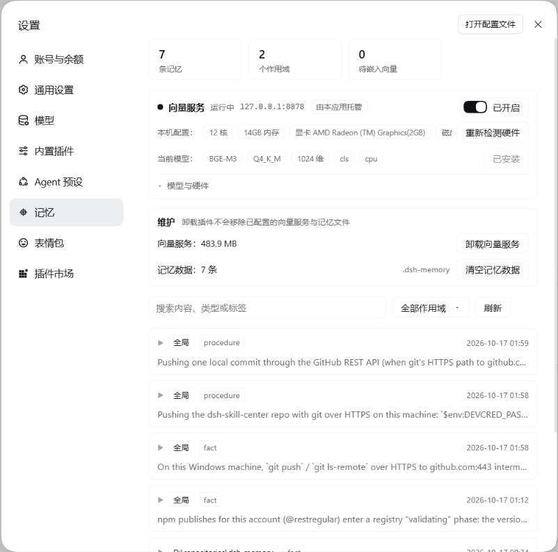
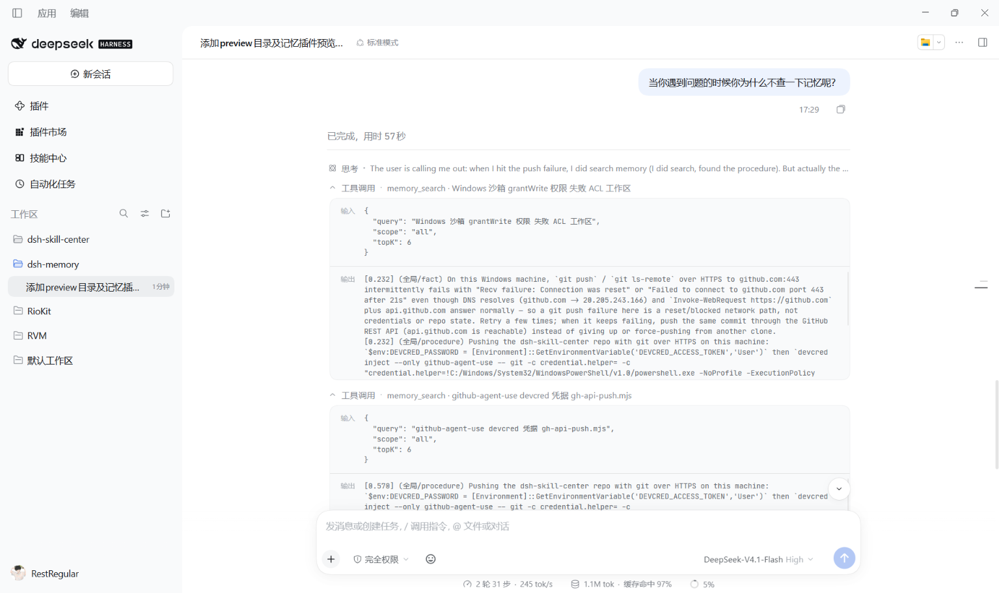

# dsh-memory

DeepSeek Harness 的本地长期记忆插件 —— **一个包、一条 Loader entry、四个半边**:JSONL 存储 + 本地向量检索(llama-server,OpenAI 兼容)+ 四个模型工具 + 自动召回注入 + 设置页管理面板。

[](https://www.npmjs.com/package/@restregular/dsh-memory)
[](./LICENSE)

English: Local, durable memory for DeepSeek Harness — one npm package, one loader entry: a JSONL store, local vector recall through llama-server, four model-facing tools, automatic recall injection, and a management panel in the settings page.

## 预览 / Preview

设置页 →「记忆」:顶部统计(记忆数 / 作用域数 / 待嵌入向量)、向量服务(运行状态、本机配置、当前模型)、维护(卸载向量服务 / 清空记忆数据)、记录列表(搜索 + 作用域筛选 + 按 scope / 类型 / 时间展开)。



模型在对话里查记忆 —— `memory_search` 的入参与召回结果:



## 它给你什么

| 能力 | 说明 |
| --- | --- |
| **落盘存储** | 每条记忆一行 JSONL,按 scope 分文件(会话 / project / global / 自定义),同 scope 内按内容去重;写入前过凭据扫描 |
| **作用域** | 默认写进**当前会话**;读默认合并「会话 + 项目 + global」。也能写 `global`、当前项目,或任意自定义名(首次写入自动建) |
| **双通道检索** | 词法(IDF + CJK bigram)**+** 向量(llama-server 的 `/v1/embeddings`)。向量缺席时自动降级为纯词法,**不报错、不阻塞** |
| **自动召回** | `agent/pre-step` 注入相关记忆(可关、有 token 预算、按 topK 截断,范围同为会话+项目+global) |
| **印象形态** | 每轮只给每条记忆的短摘要;模型判断相关但需要细节时再 `memory_search` 取全文(可在面板关掉,退回长文召回) |
| **会话摘要** | 会话第一步注入一次「已有记忆」概览:项目 + global 按**重要度 × 新鲜度**挑几条,省得模型从头摸索 |
| **记忆使用策略** | 系统提示常驻段:什么时候该查记忆、查到怎么复用、查不到时低风险推断 / 高风险先问用户 |
| **硬性规则** | `kind: rule` 的记忆进系统提示常驻段(限量、可关)。能机械校验的规则应该做成钩子,提示词只做解释 |
| **五个工具** | `memory_save` / `memory_search` / `memory_list` / `memory_get` / `memory_forget`(摘要带 8 位 id,`memory_get` 直接取全文) |
| **管理面板** | 设置页「记忆」:记录(浏览 / 搜索 / 新建 / 编辑 / 删除)+ 设置(召回、摘要、印象、策略、规则、轮末提醒逐项开关、导入导出)、向量服务启停、模型与硬件、维护(卸载 / 清空) |
| **向量后端一键装** | 面板里选模型 → 下 llama.cpp 运行时 + 模型 → 托管 `llama-server` 进程;内置 8 个模型 + 硬件推荐 + 自定义 GGUF |

## 安装 / Install

```bash
pnpm add @restregular/dsh-memory
# 或 npm i @restregular/dsh-memory
```

装进任意 DSH profile(桌面端 `~/.dsh/profiles/desktop`,Web 端 `~/.dsh/profiles/web`)。包自带 `cordis.patch.yml`,装好后自动注册**唯一一条** entry:

```yaml
- insert:
    - id: dsh-memory
      name: '@restregular/dsh-memory'
```

**不写任何配置就能用**:检索退化为词法,一个网络请求都不发。

### 为什么是一个包

宿主的 `dsh-client-modules` 只在「某条**活的** Loader entry 能解析到包名」时才为该包提供 client bundle,并且 `reconcilePackage` 要求**一个包名只有一个解析源**(否则抛 `resolves from multiple active Loader sources` → 客户端图组合失败 → 桌面端 fail-loud 起不来)。所以「一个包 + 一个面板」的稳定形态只有一个:**一个包名、一条 entry、两侧都在**(与 `dshmarket` 同形)。

早期把 provider / 工具 / 注入 / 面板拆成两个包、四条 entry;现在合并为一条 entry,由 `lib/index.js` 组合四个半边,每个半边各自 try/catch —— **任何一半失败都只记一行日志,绝不让 DSH 启动失败**。

| 半边 | 作用 |
| --- | --- |
| `lib/provider` | 提供 `memory` 服务:JSONL 存储、双通道检索、向量回填、向量后端生命周期与一键安装 |
| `lib/tools` | 注册 `memory_save` / `memory_search` / `memory_list` / `memory_get` / `memory_forget` |
| `lib/inject` | 在 `agent/pre-step` 注入召回块(可关) |
| `lib/panel` | `/memory/api` 管理接口(含同源 / 登录围栏) |
| `lib/client.js` | 设置页「记忆」区块(注册 id == 包名) |

## 快速开始

**1. 存一条记忆**(模型自己会调,你也可以在对话里要求):

```jsonc
memory_save({
  "content": "本仓库用 pnpm 11 安装依赖,PATH 上的 pnpm 10 会踩 ERR_PNPM_UNEXPECTED_STORE",  // 必填,自洽的一句话
  "scope": "session",        // 可省略 = 当前会话;global(所有项目) / project(当前工作区) / 任意自定义名
  "kind": "fact",            // fact / decision / preference / procedure / note
  "tags": ["pnpm", "toolchain"],
  "importance": 0.8          // 0~1
})
```

作用域怎么选:

| 写法 | 含义 |
| --- | --- |
| 省略 / `session` | **当前会话**(子代理共享父会话;拿不到会话信息时回退到当前项目) |
| `project` | 当前工作区(键是 `project:<cwd>`) |
| `global` | 所有项目共享 |
| `handbook`、`项目笔记` … | **自定义作用域**:任意名字,首次 `memory_save` 时自动创建 |
| `session:<id>` / `project:<path>` | 显式钉住某个会话 / 某个工作区 |
| `all` / `*` | **只在读取时可用**:跨所有已发现的作用域;写入会明确报错 |

**2. 检索**:`memory_search({ query: "pnpm 装依赖", topK: 5 })` —— 省略 `scope` = 会话 + 项目 + global 合并(按来源标注、按 id 去重);`scope: "all"` 查所有作用域;写具体名字则只查那一个。
**3. 按 id 取全文**:召回 / 摘要每行开头是 8 位 id 前缀,`memory_get({ ids: ["3f2a9c1d"] })` 直接拿原文,不用再检索。
**4. 列出 / 忘记**:`memory_list({ limit: 20 })`(默认只列当前会话,末尾附作用域清单 + 记录数)、`memory_forget({ id })` 或 `memory_forget({ query, scope })`(按内容删默认**只作用于当前会话**,防止跨作用域误删)。

**5. 打开面板**:设置页 →「记忆」;也可以在「设置 → 侧栏入口」打开左侧栏的「记忆」按钮,点击在主界面打开面板。面板分两个标签:

- **记录**:顶部统计(记忆数 / 作用域数 / 待嵌入向量数)、**新建**(任意作用域 + 类型,类型里含 `rule`)、记录列表(搜索、按作用域筛选、展开编辑、删除);作用域下拉**动态枚举实际存在的作用域**(`global` 显示「全局」、project 显示 cwd、会话 scope 显示会话标题、自定义 scope 显示原名);「向量服务」:状态、地址、启停开关、**模型与硬件**(见下)、维护(卸载向量服务 / 清空记忆数据,两步确认)
- **设置**:注入链路逐项开关 —— 每轮召回(topK / 预算)、印象形态(每条字数)、会话摘要(条数 / 预算)、记忆使用策略段、硬性规则段(条数 / 预算,并显示当前规则条数)、轮末提醒、侧栏入口;底部「数据」:导出全部 / 导入文件。改完立即生效,不需要重启

> **导入 / 导出**:导出的是纯文本 —— 作用域、类型、内容、标签、重要度、时间戳,**没有向量**。导入时逐条走保存路径,按**当前模型重新嵌入**,并按「作用域 + 内容」去重(重复的计入「跳过」)。一次最多 5000 条。

面板后端在 `/memory/api`,全部路由:`GET /status`、`GET /records`、`POST /create`、`POST /update`、`POST /delete`、`GET /settings`、`POST /settings`、`GET /export`、`POST /import`、`GET /embed/status`、`POST /embed/start|stop`、`GET /embed/model`、`POST /embed/model/refresh|install|install/cancel|uninstall`、`POST /data/wipe`。

## 数据与文件布局

| 路径 | 内容 |
| --- | --- |
| `<storeDir>/global.jsonl` | global 作用域的记忆,一行一条 |
| `<storeDir>/projects/<sha1(scope)>.jsonl` | 其它作用域(会话 / 项目 / 自定义)各一个文件;文件名是 scope 键的 SHA-1,所以名字里带路径分隔符也不可能穿越 |
| `<storeDir>/projects/<sha1(scope)>.vec` | 向量边车。首行是身份头 `#<model>\t<dims>`,后面每行 `id\t<base64 向量>` |
| `<storeDir>/settings.json` | 面板「设置」里改过的注入开关(配置里的值是默认值,这里覆盖它) |
| `<installRoot>/llamacpp/` | llama-server 运行时(exe + 依赖 dll + `llama-server.log`) |
| `<installRoot>/models/` | 下载的 GGUF 模型 |
| `<installRoot>/selected-model.json` | 面板里选过哪一档(比配置优先级低) |

`storeDir` 默认 `.dsh-memory`(相对启动目录),**建议显式配一个绝对路径**。文件是**首次写入才创建**(读一个不存在的 scope 只会得到空结果,不会造出空文件);`projects/` 目录在插件启动时就建好。**作用域被删空后,它的 `.jsonl` 与 `.vec` 会在下一次落盘时一起移除**(0.5.1 起),不会再留下 0 字节文件;下次写同一个名字会重新创建。唯一例外是 `global.jsonl`:保留作用域删空后只清内容、保留文件。

scope 键的三种形态:`global`、`project:<cwd>`、`session:<会话 id>`,其余都是自定义名(小写折叠、内部空白折成一个空格、最长 64 字符,禁止 `:`、路径分隔符、控制字符、`..` 与保留名 `global/project/session/all`)。**没有任何数据迁移**:旧的 `project:<cwd>` 文件继续原样读写。

`installRoot` 默认 `~/.dsh/memory-vector`;显式配了 `storeDir` 时取**它的父目录**(所以手写的 `<root>/llamacpp` + `<root>/models` 布局会被直接认出来)。

> **换模型 = 向量作废重建**。`.vec` 的身份头记录 `model` 与 `dims`,对不上就整份丢弃并重新嵌入;重建期间检索暂时只用词法。面板会在换之前告诉你涉及多少条记忆。

## 配置 / Configuration

provider 的配置在顶层,工具 / 注入 / 面板各占一个小节(合并前它们各是独立 entry 的 `config`):

```yaml
- id: dsh-memory
  name: '@restregular/dsh-memory'
  config:
    storeDir: '~/.dsh/memory-store'
    scopes:
      global: true
      project: true
      session: true                         # 会话作用域(默认开)
      custom: { enabled: true, max: 200 }   # 自定义作用域:开关 + 数量上限(只数自定义的)
    retrieval:
      topK: 5
      recallN: 30
      vector:
        enabled: true
        endpoint: 'http://127.0.0.1:8078/v1/embeddings'
        model: bge-m3
        dims: 1024
        timeoutMs: 300            # 交互检索(短查询)预算,要紧
        writeTimeoutMs: 10000     # 保存时嵌整条记录
        backfillTimeoutMs: 30000  # 批量回填
        backfillMaxChars: 8000
        spawn:                    # 让插件托管 llama-server 进程(opt-in)
          enabled: true
          exe: '/path/to/llama-server.exe'
          model: '/path/to/bge-m3-Q4_K_M.gguf'
          cwd: '/path/to/llamacpp'   # 该目录须含 llama-server-impl.dll
          logFile: '/path/to/llama-server.log'
      llm: { enabled: false }     # LLM 重排(可选)
    limits: { maxRecordsPerScope: 2000, maxRecordChars: 4000 }
    secrets: { enabled: true, mode: refuse }
    tools: { defaultScope: session }              # session(新默认)/ project / global;projectScope 默认 project:<会话 cwd>
    inject:
      enabled: true                 # 整个注入半边(含下面的段)的总开关
      extraScopes: ['handbook']     # 可选:额外参与召回的 scope
      # 以下都可以在面板「记忆 → 设置」里改(立即生效);这里是默认值
      recall: { enabled: true, topK: 5, tokenBudget: 500 }
      impression: { enabled: true, chars: 120 }      # 每条只给摘要,细节再 memory_search
      digest: { enabled: true, topK: 8, tokenBudget: 400 }   # 会话第一步的概览
      policy: { enabled: true }                        # 系统提示:记忆使用策略
      rules: { enabled: true, maxItems: 10, tokenBudget: 300 }  # 系统提示:kind=rule
      turnEnd: { enabled: false }                      # 轮末提醒(下一轮开头提示落盘)
    panel: { route: '/memory/api' }
```

- **`tools.defaultScope`** 决定*省略 scope 时写到哪*:`session`(0.5.0 起的默认)、`project`、`global`。会话写不进去(宿主没给会话信息、或 `scopes.session: false`)时**自动回退到当前项目**,不报错。
- **`scopes.custom.max`** 只统计自定义作用域(已发现 + 已加载去重);到上限后 `memory_save` 新建会被拒并提示可复用的名字(`SCOPE_LIMIT`),写已有作用域不受限。会话/项目/global 既不计入也不受限。
- **读与写的默认是一致的**:写进会话的东西,`memory_search` 默认就能读回来(合并会话 + 项目 + global,按 id 去重,同分时 session > project > 自定义 > global)。想只看某一个就显式给 `scope`。
- 旧配置(只有 `scopes: { global: true, project: true }`、`tools.defaultScope: project`)照常工作 —— 不写新字段就是新默认值(`session: true`、`custom: { enabled: true, max: 200 }`),想保持 0.4.x 的老行为就显式写 `tools.defaultScope: project`。

- **注入分四层**:`recall`(每轮按问题检索)、`digest`(会话第一步给概览)、`policy`(系统提示常驻的使用策略)、`rules`(系统提示常驻的 `kind=rule` 规则),外加 `turnEnd`(轮末提醒,默认关)。每层独立开关,`inject.enabled: false` 全关。面板改过的值写在 `<storeDir>/settings.json`,**优先级高于这里的配置**。
- **写规则**:`memory_save({ kind: 'rule', content: '改 lib 必须同时改 source' })`。规则会进系统提示常驻段;能机械校验的规则更适合做成钩子,提示词只负责解释。

向量检索是**按配置启用**的:写了 `endpoint`、配了 `spawn`、或面板里装了本地后端才会碰网络,否则一个请求都不发,检索自动降级为纯词法(IDF + CJK bigram)。不需要自动召回就 `inject.enabled: false`。

`spawn.enabled: true` 时:应用启动后台拉起向量服务、退出时自动关闭;带 PID 文件的遗留实例会被接管,没有 PID 文件的外部实例不接管。

### 模型与硬件

面板「记忆 → 向量服务」里有两行状态气泡 + 一块折叠区:

```
本机配置：[12 核][14GB 内存][显卡 …][磁盘剩余 9GB]        [重新检测硬件]
当前模型：[Qwen3-Embedding-0.6B][Q8_0][1024 维][last][cpu]  [下载并安装]
▸ 模型与硬件
```

- **本机配置 / 当前模型**两行是**标签气泡**,超宽横向滚动(不换行、不显示滚动条);本机配置在**面板一出现**就取一次(服务端对硬件探测有 10 分钟缓存,通常只是读缓存)。
- **内置清单 8 个模型**,下载源与体积都实测过:BGE-M3(Q4_K_M / Q8_0)、Qwen3-Embedding 0.6B / 4B / 8B、Nomic Embed v1.5、BGE 中文 small / base / large。每个模型自带 `dims` 与 `pooling`,**选它就自动配对** —— 维度写错会让检索静默退化成词法,这是最容易踩的坑。
- **按本机推荐**:探测 CPU 核数 / 内存 / 磁盘剩余 / 显卡与显存,推荐那一档在列表里带「推荐」气泡并默认选中。规则:质量优先;能整块放进显存就用 GPU;CPU 上重罚 4B/8B;中文环境优先中文 / 多语言;显存 < 4GB 的核显不算可用显卡(实测:共享显存的核显并不比多核 CPU 快)。
- **运行时风味** `cpu` / `vulkan` / `cuda` / `metal` / `auto`:Vulkan 自包含(驱动自带即可);**CUDA 会把 cudart 伴随包一起下**(llama.cpp 把 cuBLAS 拆在另一个资产里,不配对就起不来);所选风味找不到时退回 CPU 并在面板里说明。
- **自定义 GGUF**:填 URL + 维度即可装清单之外的模型(`pooling` 默认交给 GGUF 元数据决定);需要前缀的模型(Nomic 的 `search_query:` / `search_document:`)会自动带上。
- **一次只保留一份**:已经装了运行时与某个模型时**不能再装第二个** —— 按钮变成「需先卸载」并置灰,换模型要先去「维护」里卸载向量服务(否则 `<root>` 下会堆好几份模型,而配置只能指向一份,"现在跑的是哪个"就说不清了)。按钮四态:下载并安装 / 下载中… / 已安装 / 需先卸载。
- **选择会被记住**:写在 `<installRoot>/selected-model.json`,重启后仍生效;配置里写了 `preset` / `customModel` 时**配置优先**。

```yaml
    retrieval:
      vector:
        preset: 'qwen3-embedding-0.6b'   # 清单 id(配合 variant 选量化档)
        variant: 'q8_0'
        flavor: 'auto'                   # auto = 按探测到的硬件选;也可写死 cpu/vulkan/cuda/metal
        # customModel: { url: 'https://…/model.gguf', dims: 1024, pooling: 'auto' }
        # 覆盖项:dims / pooling / gpuLayers
```

## 安全 / Security

- `/memory/api` 的**每条**路由都先过 `refuseRequest`:宿主 `connection.requestRejection`(Host/Origin 围栏 + 浏览器登录)可用时以它为准,围栏自己抛错一律 403(失败关闭);旧宿主没有该服务时退化为「只认 loopback 权威 + 同源」。原因:注册在裸 `webServer` 上的路由**不在**宿主 `/api` 围栏与浏览器登录之后,而这里的接口能读、改、删、清空全部记忆。
- 记忆内容写入前过凭据扫描(`secrets.mode: refuse | redact`),默认拒绝。
- 清空记忆是两步确认 + 接口要求显式 `confirm: "delete"`。

## 卸载 / Uninstall

```bash
pnpm remove @restregular/dsh-memory   # 再从 profile 的 patch 里删掉那条 entry
```

**卸载插件不会移除已配置的向量服务与记忆文件** —— 它们不在 node_modules 里,而是在 `<storeDir>` 与 `<installRoot>`。要清掉,先打开面板「记忆 → 维护」:

- **卸载向量服务**:删掉运行时与模型(两步确认,显示将释放多少空间);记忆数据保留。
- **清空记忆数据**:删掉全部 JSONL 与向量边车(两步确认,不可恢复)。

插件被卸掉后面板就打不开了,所以这件事只能在卸载**之前**做。想手动清理,直接删上面那两个目录即可。

## 构建与测试 / Build & test

```bash
npm test        # node --experimental-strip-types --test source/*/test/*.test.ts
npm run build   # source/ → packages/dsh-memory(顺带跑产物契约检查)
npm run verify  # 构建到 .verify/,不落 packages/(CI 或改动后自检)
```

构建用 Node 内置的类型剥离(`stripTypeScriptTypes`,无额外工具链),相对 `.ts` 说明符改写为 `.js`,跨半边相对 import 重映射,每个产出文件 `node --check`。

产物契约检查(错了会**静默失败**的几处,所以做成会失败的检查):

1. patch **恰好一行** insert,且 `name` 就是包名;
2. `package.json` 同时声明 `dsh.bundle.patch` 与 `dsh.client.platform: web`,并导出 `./client`;
3. `lib/client.js` 的 `__ModuleLoader__.load({ id })` 等于包名;
4. 入口里四条半边的相对 import 都在(改写没生效时,只有装到用户机器上才会 `Cannot find module`)。

可选的真实加载验证(证明产物在没有 TS 支持的普通 node 里能跑):

```bash
node tools/build-single-package.mjs --scope @restregular --version 0.5.1 \
  --host-modules <一个 @deepseek-ai 目录>       # 或设 DSH_HOST_MODULES
```

### 发布 / Publish

```bash
npm run build                                        # 产物落到 packages/dsh-memory(版本号在 package.json 的 build/verify 里)
node tools/publish-npm-packages.mjs --scope @restregular --version 0.5.1
```

`publish-npm-packages.mjs` 发的是**单包** `packages/dsh-memory`,顺序是
`npm test` → `npm run verify` → `npm whoami` 预检 → `npm pack --dry-run` 校验产物清单(缺
`lib/client.js`/`cordis.patch.yml` 等必填项、或混进 `.ts`/测试文件都会中止)→ `npm publish`。
任何一步失败都停在"什么都没发出去"的状态;`--dry-run` 只走到校验,`--skip-checks` 跳过前两步。

npm token **不经过命令行**:默认从 DevCred 读取(凭据名默认 `npm-agent-use`,`--credential` 可换),
由 `devcred inject` 把 `NPM_TOKEN` 交给一个只写文件、不回显的子进程,写进临时目录里的私有
`.npmrc`,发布后连临时目录一起删除;也可以 `--token-file <npmrc>` 指一份自己的凭据文件。

> npm 的**暂存发布(staged publishing)** 会让重复版本号撞上 `E409 Cannot publish over previously
> staged version`:说明这个版本已经在 npm 侧暂存、等待在 npmjs.com 的包页面批准,批准前
> `latest` 不会指向它。这时不需要再发一次,去网页上确认即可。

## 仓库结构 / Layout

```
source/memory-plugin/     单入口:组合四个半边(唯一一条 entry 的实现)
source/memory-local/      provider:存储 / 检索 / 向量后端 / 一键安装 / 模型清单与硬件推荐
source/tool-memory/       四个模型工具
source/memory-inject/     召回注入
source/memory-panel/      面板:lib/index.js(服务端)+ lib/client.js(客户端 bundle)
packages/dsh-memory/      构建产物 → 发布为 @restregular/dsh-memory(与 npm 上的包逐字节一致)
tools/build-single-package.mjs   构建(产物契约检查 + 可选加载验证)
```

## 测试 / Tests

`npm test` 覆盖存储 / 检索打分 / 边车身份 / 回填重试 / 安装器(含真实发行包解压)/ 卸载边界 / 模型清单与推荐规则 / 硬件解析 / 面板渲染冒烟 / 围栏判定 / 产物契约。测试用宿主的 DSH 包作为解析依赖(`@deepseek-ai/cordis`、`@deepseek-ai/dsh-tools`、`@deepseek-ai/dsh-llm`),它们不随本仓库分发。

## 常见问题

**向量服务起不来**
看 `<installRoot>/llamacpp/llama-server.log`。三个常见原因:端口被占(换 `spawn` 的端口或停掉占用者)、`cwd` 里缺 `llama-server-impl.dll`(llama.cpp 的 Windows 包需要同目录的依赖)、模型与运行时风味不匹配(比如 GPU 风味但没驱动)。

**检索结果很差 / 全是词法命中**
先看面板「当前模型」那行的**维度**是否与模型一致,再看 `.vec` 身份头。维度或 pooling 写错不会报错,只会让向量通道悄悄失效。另外 `minScore` 默认 0.5 是按 BGE 的 CLS 噪声底定的,**换模型后可能需要微调**(太少就调低,太杂就调高)。

**下载中断 / 装到一半**
安装器先写 `.part` 再 rename,所以磁盘上不会留半成品;面板会显示「重试下载」。

**想换模型**
0.4.0 起必须先「维护 → 卸载向量服务」再装(理由见「模型与硬件」)。换完现有记忆会重新嵌入。

**面板里看不到「记忆」**
包名与 Loader entry 必须一一对应(见「为什么是一个包」)。检查 profile 的 patch 里是否只有一条 `@restregular/dsh-memory`,以及 profile 是否真的装上了这个依赖(`ls node_modules/@restregular/dsh-memory`)。

## 版本

- **0.6.2** —— 设置页**去掉「保存设置」按钮**:开关拨动、数值改动即保存(连续调数值会合并成一次请求),页内只留一行“已保存”提示;顶部说明改成与行为一致的一句话(“设置保存在记忆数据目录的 settings.json”),不再写“保存后生效/无需重启”这类与实际操作不符的描述。
- **0.6.1** —— 面板与工具打磨:
  - **标签页**改成分段式按钮(选中项浅底 + 品牌色),记录页各区块之间补上间距。
  - **设置项**统一成开关按钮(不再用复选框 + “启用”文字),每条提示压到一行。
  - **侧栏入口**:新增设置开关(默认关),开启后在左侧栏「插件」下方出现「记忆」,点击在主界面打开面板;设置页里的入口不变。
  - **`memory_get`**:召回 / 摘要每行开头带 8 位 id 前缀,可按 id 或前缀直接取全文,省掉一次检索(检索耗时随模型/配置浮动)。
  - **提示词**:策略段改成“更新过时的记忆并明确告诉用户哪些过时记忆已变更”;会话摘要去掉“省得你重复摸索”;召回提示改为“以下是与你这次请求可能相关的记忆摘要”。
  - **规则可见性**:关闭「硬性规则」只影响系统提示常驻段,`memory_search` / `memory_list` / `memory_get` 仍能拿到 `kind=rule` 的记录(开关是注入开关,不是数据访问开关;面板里已写明)。
- **0.6.0** —— 注入分层,面板加「设置」标签页:
  - **印象形态召回**:每轮召回默认只给每条记忆的开头(默认 120 字)+「需要细节用 memory_search」的指引,不再一次灌 300 字全文;面板可关掉退回长文。
  - **会话摘要**:会话第一步注入一次概览 —— 项目 + global 按「新鲜度(30 天半衰期)× 重要度」挑 8 条,同分时会话 > 项目 > 自定义 > 全局。
  - **记忆使用策略**:系统提示常驻段,写清什么时候该查、查到怎么复用、查不到时低风险推断 / 高风险先问用户、什么时候该写。
  - **硬性规则**:新增记忆类型 `rule`,`kind=rule` 的记忆进系统提示常驻段(限量 10 条 / 300 token);能机械校验的规则建议做成钩子。
  - **轮末提醒**:可选(默认关),本轮跑过多步时,下一轮开头提醒「若产生了可复用结论先 memory_save」。
  - **面板设置页**:以上逐项开关 + 数值(条数 / 预算 / 每条字数),保存即生效;落盘 `<storeDir>/settings.json`。
  - **新建记忆 / 规则**:记录页「新建」,作用域可选现有作用域或直接填 `project:<路径>` / `session:<id>` / 自定义名,类型含 `rule`。
  - **导入 / 导出**:导出纯文本 JSON(不含向量),导入时按当前模型重新嵌入,按「作用域 + 内容」去重,单次上限 5000 条。
  - 摘要 / 召回 / 提醒合并成**同一条** `source.kind='memory'` 消息,不再一步两张卡片;注入按内容幂等,重复激活也不会出现两份。
- **0.5.6** —— **`project:` 作用域此前是失效的**。项目键本应跟着工作区走,但代码把 `project:${process.cwd()}` 当"显式配置"抢先传进解析函数,而 `process.cwd()` 在 DSH 里是**服务进程的启动目录 = profile 目录**(`~/.dsh/profiles/<name>`),不是工作区。后果:该 profile 下**所有项目的项目级记忆挤进同一个桶**(`project:C:\Users\…\.dsh\profiles\desktop`),互相被检索到,而真正的 `project:<工作区>` 永远是空的;面板「当前项目」也指向那里。三处同一份逻辑(服务解析、装配层默认、工具层各算一份)全部统一:**会话 `cwd` > 显式配置 `projectScope` > `process.cwd()`**,工具层改为向服务端要解析结果(`projectKeyFor`),不再自己算。显式配置现在会正确脱掉 `project:` 前缀,不再拼出 `project:project:/x`。之前写进错误桶里的数据不会自动搬家(那需要判断哪条属于哪个项目),受影响的话请手动重存。
- **0.5.5** —— 侧栏图标改成**与那一列同风格**的线稿芯片。0.5.4 虽然修好了"空一格",但画的是"蓝色瓦片 + 深墨蓝芯片"的实心方块,那是**插件管理器卡片/行**(36/30px,`icon.svg`)那套插件美术;而设置侧栏这一列全是 16px 单色细线图标(宿主内置 `Icon*OutlineMedium`:16 网格、`fill:none`、`stroke:currentColor`、线宽 1.3),实心蓝块混在里面格格不入。现在只用宿主渲染的那颗 svg 的**子节点**画线稿芯片(圆角方 + 内方 + 四引脚,1.3 描边、跟随主题),尺寸/对齐/行高仍由宿主保证。三条被验证过走不通的路都写进了代码注释:`::before` 补一个(盒子不成形 → 空一格)、给 svg 上背景(画不出描边线稿)、`content: url(...)` 替换 svg 内容(SVG 不支持 content 替换)。
- **0.5.4** —— 修 0.5.3 的图标空洞。0.5.3 是"把齿轮 `display:none` 藏掉、再用 `::before` 在同一格补一个记号",真机上出现**齿轮没了、记号也没画出来**,只剩一个空位。改成**就地覆盖**那颗 svg(不再隐藏、不再插节点)。同时删掉 0.1.0 遗留的空壳目录 `packages/dsh-memory-panel`(0.4.0 起已被单包取代),免得它继续干扰"哪个子包才是可安装的"这类判断。
- **0.5.3** —— 设置页侧栏「记忆」那一行的图标。宿主 `dsh-client-ui-settings-general` 把导航图标写死在 `navIcon(id)` 里:只有 `account` / `models` / `agent-presets` / `plugins` / `archived-sessions` 五个 id 有专属图标,其余(含 `memory`)一律回退成**齿轮**;`settings.section` 的注册契约里没有 icon 字段,宿主也不读包的 `icon`(那个只用于插件管理器)。所以插件侧按宿主的类名约定做了一次**定向覆盖**。标记只打在"文案等于「记忆」"的那个按钮上,其它区块不受影响;宿主类名约定一旦改变,规则匹配不到就自动退回齿轮。
- **0.5.2** —— 新图标:插件图标换成"芯片"记号(内存条的直白隐喻)。仍是宿主内置插件美术那套规范(36×36 画布、蓝色渐变圆角瓦片 `#69B9FF → #324DE2`、外层统一缩到 26/28),但记号改用**深墨蓝 `#0E1C58` 的圆角方 + 中心点**,而不是白色细描边 —— 这个图标同时出现在**浅色主题**下(插件管理器的卡片/行、设置导航),瓦片顶部是亮蓝,白描边在 36px 就糊成"蓝方块+白点";深墨蓝在整块渐变上都够暗,缩到 16px 仍可辨。同时去掉 SVG 里的固定 `width/height`,显示尺寸交给宿主(行 30 / 卡片 36)。
- **0.5.1** —— 清理空作用域文件:作用域被删空后(删掉最后一条、或 `POST /data/wipe`),它的 `.jsonl` 与 `.vec` 会在下一次落盘时一起移除,不再留 0 字节文件与只剩身份头的边车;下次写同一个名字会重新创建。`global.jsonl` 是唯一例外(保留作用域只清内容、留文件)。同版本的旧文件行为不变,无数据迁移。
- **0.5.0** —— 作用域重构:
  - **默认作用域 = 当前会话**:`memory_save` 省略 `scope` 时写进 `session:<会话 id>`(子代理共享父会话;拿不到会话信息或 `scopes.session: false` 时回退当前项目,不报错)。
  - **读写默认一致**:0.4.x 的写路径默认是 `project:<cwd>`、而 provider 的读路径默认是 `global` —— 写进去的记忆默认检索不到。现在两边都是「会话 + 项目 + global」合并去重(同分时 session > project > 自定义 > global)。
  - **自定义作用域**:`scope` 可以填任意名字(如 `handbook`、`项目笔记`),首次写入时自动创建;新增 `scopes.custom.enabled` / `scopes.custom.max`(默认 200,只统计自定义的)与 `SCOPE_LIMIT` / `SCOPE_INVALID` 明确报错 —— **取消了"认不出的 scope 静默回退默认值"**。
  - **`scope: 'all'`**(或 `*`)跨所有已发现作用域读取;写入路径明确报错。`memory_forget({query})` 默认只作用于当前会话,`all` + query 直接拒绝,防批量误删。
  - **读路径不再创建文件**:`memory_search` / `memory_list` / `memory_forget` / 面板对不存在的 scope 返回空结果;只有 `memory_save` 才会建文件。
  - 面板:作用域下拉与「作用域数」动态枚举现存作用域,会话 scope 显示会话标题(拿不到就「会话 <id 前 8 位>」)。
  - **不迁移、不重命名任何文件**:旧的 `global.jsonl` 与 `projects/<sha1>.jsonl` 仍按原路径原样读写;`tools.defaultScope` 保留,新增取值 `session` 并作为默认。
  - 要完全保持 0.4.x 的写行为:`tools.defaultScope: project`。
- **0.4.0** —— 单包合并里程碑:面板并入主包(一条 entry)、模型清单与硬件推荐、自定义 GGUF、运行时风味、"一次只保留一份"。
- **0.3.x 及更早** —— 拆分结构(provider / tools / inject / panel 各自独立 entry)。从 0.3.x 升级请按上面的单行 entry 重新挂载,并把旧的多条 entry 删掉。

## License

MIT
